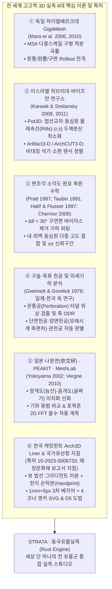
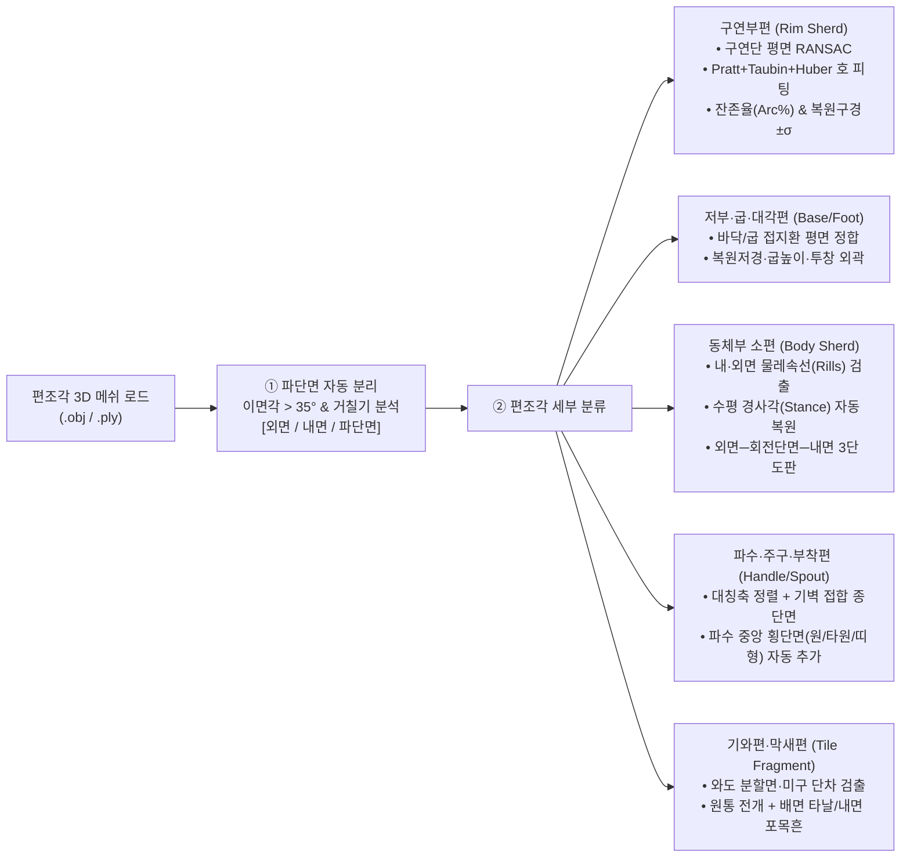
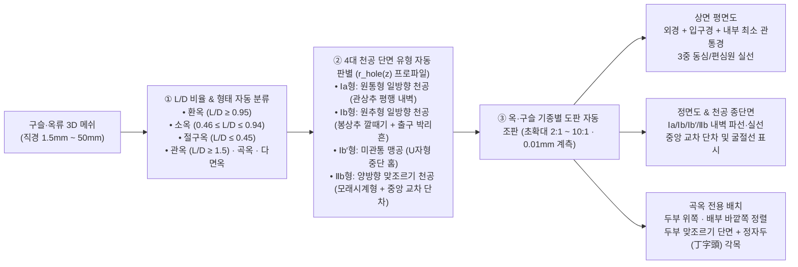
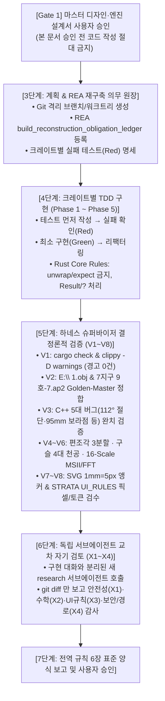

# STRATA · 동국유물실측 (DongArch3D) Rust 마스터 디자인 설계서 및 엔진 명세서

> [!IMPORTANT]
> **문서 지위 및 게이트 조건**: 본 문서는 사용자 지침(*"첫째 디자인 설계서부터 아주 세밀하게 만든 뒤 사용자를 통과해야 다음으로 넘어간다. 디자인 설계서가 통과 안 되면 절대 다음으로 넘어갈 수 없다"*)과 전역 개발 규칙(1단계 요청 정리 · 2단계 명세)에 따라 작성된 **마스터 디자인·엔진 설계서**입니다. 본 설계서가 사용자의 승인을 통과하기 전까지 어떠한 코드 작성도 시작하지 않습니다.

---

## 0. 요청 정리 (무엇을·왜 하는가 / 하지 않을 것 / 핵심 설계 원칙)

### 0.1 무엇을 왜 하는가
1. **목표**: 현행 C++ 기반 [DongArch3DStudio](file:///D:/_dongarch_build/wt/.worktrees/JOB-010/studio/src/MainWindow.cpp)의 검증된 작업 흐름([UI_RULES.md](file:///D:/_dongarch_build/wt/.worktrees/JOB-010/docs/ui/UI_RULES.md))과 첨부된 **`STRATA · 디자인 기준` (6페이지 PDF)**의 시각 체계를 100% 계승·발전시키고, [gigamesh_arch3d_3d_obj_ply_탁본.html](file:///c:/Users/kyi25/Downloads/gigamesh_arch3d_3d_obj_ply_탁본.html) 및 `E:\` 실측 데이터([1.obj](file:///e:/1/1.obj), [7지구 9호-7.ap2](file:///e:/034(7-실4-4)/7지구%209호-7.ap2), [ret](file:///e:/034(7-실4-4)/ret), [유물제도선.ai](file:///e:/유물제도선.ai))의 핵심 도법·알고리즘을 흡수·초월하여 **세상에 단 하나뿐인 고고학 유물 실측 전용 Rust 네이티브 애플리케이션(`STRATA · 동국유물실측`)**을 구축합니다.
2. **왜 기존 앱과 상용 툴(Arch3D Liner, GigaMesh)을 능가해야 하는가**:
   - 실제 발굴 현장에서 출토되는 유물의 **80~90% 이상은 완형 토기가 아니라 무수히 다양한 『편조각(구연편·저부편·굽편·대각편·동체부편·파수/주구편·기와편)』과 『구슬·옥류(곡옥·관옥·환옥·소옥·다면옥) 및 소형 유물』**입니다.
   - 기존 C++ 앱과 상용 툴은 완형 회전체 위주로 설계되어 있어, ① 깨진 **파단면(Fracture surface)**이 지름 추정(원 피팅)에 섞여 복원구경이 왜곡되고, ② 동체부 소편의 **물레속선(Rills) 경사각 복원** 및 **외면·회전단면·내면 3단 병렬 도판** 자동 조판이 부재하며, ③ 구슬·옥류의 생명인 **미세 관통공(천공 축·단면/양면/관천공 테이퍼)·곡옥 C자형 대칭면·다면옥 연마면 전개·초확대 축척(`2:1`~`10:1`, `0.01 mm` 단위)**을 지원하지 못합니다.

### 0.2 절대 하지 않을 것 (Anti-Goals & Zero-Clutter 원칙)
1. **화면을 복잡하게 만드는 장식·패널 추가 금지**:
   - 다크 모드 대시보드, 상시 노출되는 우측 속성 패널, 하단 대형 치수 표, 20개짜리 플로팅 아이콘 팔레트, 쓸데없는 3D 기즈모/셰이더 파라미터 나열을 **일절 금지**합니다.
2. **실무에 쓰지 않는 기능 노출 금지 ("꼭 필요한 것은 크게, 부수적인 것은 작게 숨김")**:
   - 실측 전문가가 매일 쓰는 핵심 행동(`열기` → `① 바닥·축·경사각 정하기` → `② 막으로 자르기` → `③ 도면·탁본 다듬기` → `도판·검수·내보내기`)만 `50×50 px` 리본 타일로 명확히 두고, 세부 수치 보정(파단면 민감도, 곡률 반경 등)은 기본값으로 자동 동작하되 필요할 때만 여는 작은 팝오버(`더보기`)로 숨깁니다.
3. **기존 C++ 워크트리 훼손 금지**:
   - 기존 C++ 코드([D:\_dongarch_build\wt\.worktrees\JOB-010](file:///D:/_dongarch_build/wt/.worktrees/JOB-010))는 건드리지 않고, 별도 격리된 Rust 워크스페이스(`strata-arch3d`)에서 독립 구축합니다.

---

## Part 1. REA 바이너리·소스 감사 및 전 세계 고고학 3D 실측 이론·학습데이터 총람

### 1.1 현행 C++ `DongArch3DStudio` REA 정밀 감사 및 반드시 고쳐야 할 5대 결함
[DongArch3DStudio.exe](file:///D:/_dongarch_build/wt/.worktrees/JOB-010/studio/build-msvc/DongArch3DStudio.exe) (`SHA-256: 3964610b...`, 905개 프로시저) 및 C++ 소스([ArtifactDoc.cpp](file:///D:/_dongarch_build/wt/.worktrees/JOB-010/studio/src/ArtifactDoc.cpp), [SheetView.cpp](file:///D:/_dongarch_build/wt/.worktrees/JOB-010/studio/src/SheetView.cpp))를 REA 및 정적 분석으로 전수 감사한 결과, Rust 엔진에서 즉시 해결해야 할 **5대 구조적 결함**을 특정했습니다:

| 번호 | 현행 C++ 코드 위치 | 발견된 실제 결함 및 한계 | Rust 엔진(`strata-arch3d`) 해결책 |
|---|---|---|---|
| **1** | [`ArtifactDoc.cpp:2721`](file:///D:/_dongarch_build/wt/.worktrees/JOB-010/studio/src/ArtifactDoc.cpp#L2721) | `rimGapChart()`가 `for (int a = 0; a <= 112; a += 4)`로 **112°까지만 하드코딩**되어 112°~360° 구연 접지 오차가 잘림 | `0°~360°` 전 구간(2° 간격 180빈) 스캔 + 편조각의 실제 잔존 호 구간 $[\theta_{\min}, \theta_{\max}]$ 자동 하이라이트 |
| **2** | [`ArtifactDoc.cpp:2798-2810`](file:///D:/_dongarch_build/wt/.worktrees/JOB-010/studio/src/ArtifactDoc.cpp#L2798-L2810) | `angleDefectScore()`가 각도 `angleDeg`와 무관한 고정 `wallProfile_` 분산을 매번 중복 계산하며, `confirmPose` 시 72개 각도를 단일 스레드로 순회(`1,134.5 ms` 소요) | `rayon` 병렬 LBVH 슬라이싱으로 각도별 실제 **구연 도달 결손·바닥 도달 결손·스캔 공백률·두께 연속성**을 평가하여 **`80 ms` 이내**에 최적 단면각 추천 |
| **3** | [`SheetView.cpp:243-256`](file:///D:/_dongarch_build/wt/.worktrees/JOB-010/studio/src/SheetView.cpp#L243-L256) | 유물 크기와 무관하게 무조건 높이 `H = 95.0 mm`에 보라색 점(`#6b4fc0`)을 찍는 하드코딩 버그 (소형 편·구슬에서 허공에 찍힘, 색상 규칙 위반) | 하드코딩 완전 제거, 실제 최대경 높이 또는 사용자가 지정한 계측 높이에서만 `STRATA` 표준 토큰(`#B5573A`)으로 표시 |
| **4** | [`MeshSlicer.h`](file:///D:/_dongarch_build/wt/.worktrees/JOB-010/GigaMesh/gui/src/dongarch/karch/MeshSlicer.h) / [`TaubinFit.h`](file:///D:/_dongarch_build/wt/.worktrees/JOB-010/GigaMesh/gui/src/dongarch/karch/TaubinFit.h) | 편조각의 **파단면(깨진 단면)**과 **원래 기벽(내·외면)**을 분리하지 않아, 원 피팅 시 파단면 정점이 섞여 복원구경이 크게 틀어짐 | **이면각($>35^\circ$) 능선 그래프 + 곡률 거칠기 기반 3영역 분할(`외면` / `내면` / `파단면`)**로 파단면을 원 피팅에서 100% 배제 |
| **5** | [`ArtifactDoc.h`](file:///D:/_dongarch_build/wt/.worktrees/JOB-010/studio/src/ArtifactDoc.h) / [`Plate.cpp`](file:///D:/_dongarch_build/wt/.worktrees/JOB-010/studio/src/Plate.cpp) | **구슬·옥류(관통공 축·단면/양면 천공·곡옥·다면옥·`3:1~10:1` 초확대 축척)** 및 **동체부편 3단 병렬 도판(외면-단면-내면)** 미지원 | **6대 유물군 전용 기하 엔진 + 8종 표준 보고서 도판 조판기** 내장 |

---

### 1.2 전 세계 고고학 유물 3D 실측 핵심 이론·논문·서적 총람 (언어 불문 검증된 이론 흡수)

비록 Rust로 작성된 선행 고고학 실측 앱은 전 세계에 없으나, C++/MATLAB/Python으로 발표된 세계 최고 수준의 **고고학 기하학(Computational Archaeology) 논문·특허·서적**의 수학적 알고리즘을 모두 흡수하여 Rust로 통합합니다.



| 분야 | 핵심 논문 / 특허 / 학술 서적 | 흡수하는 핵심 수학·알고리즘 |
|---|---|---|
| **편조각 회전축 및 경사각(Stance) 복원** | • **Karasik, A., & Smilansky, U. (2008)**, *"3D scanning technology as a standard archaeological tool for pottery analysis: practice and theory"*, Journal of Archaeological Science, 35(5), 1148–1168.<br>• **Halíř, R., & Flusser, J. (1997)**, *"Estimation of Profiles of Sherds of Archaeological Pottery"*, Czech Pattern Recognition Workshop.<br>• **Wilczek, J. et al. (2018)**, *"Computer-assisted orientation and drawing of archaeological pottery"*, Journal of Cultural Heritage, 30, 123–134. | 구연이나 바닥이 깨진 **편조각(Sherd)**에서 ① 표면 법선(Normal lines)들의 3D 최소제곱 교차직선, ② 내·외면 물레속선(Rills/Striae)의 수평 동심원 피팅, ③ $(r, z)$ 투영 시 기벽 단면 두께 분산($\text{Var}(w(z))$) 최소화를 결합하여 **완형이 아닌 5% 잔존 편조각에서도 정확한 회전축과 원래 기벽 경사각(Stance)을 복원** |
| **소형 구연편·저부편 지름 복원 및 불확실성 정량화** | • **Taubin, G. (1991)**, *"Estimation of planar curves, surfaces, and nonplanar space curves defined by implicit equations"*, IEEE TPAMI, 13(11), 1115–1138.<br>• **Pratt, V. (1987)**, *"Direct least-squares fitting of algebraic surfaces"*, SIGGRAPH '87.<br>• **Chernov, N., & Lesort, C. (2005)**, *"Least squares fitting of circles"*, JMIV, 23(3), 239–252. | 기존 Kåsa 원 피팅이 잔존 호 $\Delta\theta < 30^\circ$인 소편에서 반지름을 25~40% 작게 추정하는 치명적 바이어스를 **Pratt/Taubin 초기해 + Huber Loss Levenberg-Marquardt 기하 피팅 + 다중 높이 동심원 제약**으로 해결하고, 야코비안 공분산으로 **복원구경 $\hat{D} \pm \sigma$ (mm) 및 잔존율($\text{Arc}\%$)** 산출 |
| **파단면(깨진 면) 자동 분리 및 비대칭 편 정렬** | • **Kampel, M., & Sablatnig, R. (2003)**, *"Rule based system for archaeological pottery classification"*, Pattern Recognition Letters.<br>• **Rusinkiewicz, S. (2004)**, *"Estimating Curvatures and Their Derivatives on Triangle Meshes"*, 3DPVT.<br>• **Grosman, L., Smikt, O., & Smilansky, U. (2008)**, *"On the application of 3-D scanning technology for the documentation and typology of lithic artifacts"*, JAS, 35(12), 3101–3110. | 정점별 주곡률 텐서 $(\kappa_1, \kappa_2)$와 이면각($>35^\circ$) 능선 분할을 통해 편조각 메쉬를 **`외면(Outer)` / `내면(Inner)` / `파단면(Fracture)`**으로 자동 분할. 파단면은 축/지름 계산에서 자동 제외하고 도판에서는 파단 경계선으로 제도 |
| **구슬·옥류(곡옥·관옥·소옥·다면옥) 천공 및 정위치 실측** | • **Gwinnett, A. J., & Gorelick, L. (1979)**, *"Ancient Lapidary: A Study Using Scanning Electron Microscopy and Functional Analysis"*, Expedition, 22(1).<br>• 국립문화재연구소, **『한국의 고대 유리 / 옥(玉) 분석 보고서』** 및 **『매장문화재 발굴조사 보고서 작성 지침』**. | 구슬·옥류의 **관통공(Perforation tunnel) 내벽 정점 분리 및 천공 중심축 ODR 정렬**, 종단면 내벽 프로파일 $r_{\text{hole}}(z)$ 미분을 통한 **① 단면 천공(원추형 테이퍼 각도), ② 양면 천공(모래시계 접합부 높이비 및 축 편차 $\Delta e$ mm), ③ 관천공(원통형)** 자동 판별, 곡옥 C자 대칭면 정렬, 다면옥(14/18면옥) 평면 클러스터링 전개 |
| **디지털 탁본(정밀 탁본) · 5대 미분기하 특징선 · 포목흔 계측** | • **Mara, H. et al. (2010)**, *"GigaMesh and Gilgamesh — 3D Multiscale Integral Invariant (MSII)"*, VAST 2010.<br>• **DeCarlo, D. et al. (2003)**, *"Suggestive Contours for Conveying Shape"*, SIGGRAPH 2003.<br>• **Ohtake, Y. et al. (2004)** / **Yoshizawa, S. et al. (2005)**, *"Ridge-Valley Lines on Meshes via Implicit Surface Fitting"*, SIGGRAPH.<br>• **Judd, T. et al. (2007)**, *"Apparent Ridges for Line Drawing"*, SIGGRAPH 2007.<br>• **Kolomenkin, M., Shimshoni, I., & Tal, A. (2008)**, *"Demarcating Curves for Shape Illustration"*, CVPR / SIGGRAPH Asia (고고학 유물 음각·양각 문양 경계 추출).<br>• **캐럿펀트 등록특허 제10-2023-0006733호**, *"3차원 스캔 데이터로부터 유물의 디지털 탁본 이미지를 생성하는 방법"*.<br>• **Yokoyama, R. et al. (2002)**, *"Visualizing topography by openness (양개도·음개도)"*, PE&RS. | ① **뷰 법선 그라디언트 미분 + 한지 손탁본(`Handprint`) 질감**, ② **16-Scale MSII 다중 스케일 구형 적분 불변량**(마모된 인화문·집선문·명문 검출), ③ **5대 미분기하 특징선(`Silhouette` · `Suggestive Contours` · `Crest Lines` · `Apparent Ridges` · `Demarcating Curves`) 벡터 추출**(특히 곡률 미분 영교차점인 `Demarcating Curves`로 문양 단차 시작선과 물레속선을 정확히 벡터화), ④ 기와 내면 **포목흔 `1×1 cm` 2D FFT 주파수 피크 기반 마포 올수(`N×M 올/cm²`) 자동 계측** |
| **다중 편조각 파단면 분리 및 가상 접합 (Virtual Refitting)** | • **Yao, S., & Zhou, M. (2023)**, *"Structure-from-Sherds: Incremental 3D Reassembly of Axially Symmetric Pots from Sherds"*, ICCV 2023.<br>• **BAISER (2024)**, *"A Baseline for Maid-in-Order Reassembly of Ancient Pottery via Axis-based Edgeline Descriptor"*, Computers & Graphics. | 주곡률($\tau_\kappa=1$) 및 법선 편차($\tau_\theta=4^\circ$) 영역 확장(`Structure-from-Sherds++`)으로 편조각의 **내벽·외벽·파단면 3분할**을 자동 수행하고, 동일 유구 출토 다중 파편 간 **회전축 정렬 기반 파단선 디스크립터(`BAISER`) 가상 접합 후보**를 탐색 |

---

### 1.3 국내외 11대 3D 고고학 유물 학습·검증 데이터셋 및 사이트 인벤토리

엔진의 자동 분류(완형/편조각/구슬/기와/석기/금속), 파단면 분리(`Structure-from-Sherds++`), 24차원 특징 기반 문양·조정흔 분할(`burn-wgpu` / `ort`), 그리고 축·단면·탁본 정확도를 검증·학습하기 위해 활용할 **보유 실측 데이터(`E:\`)** 및 **국내외 11대 공개 고고학 3D 벤치마크 데이터셋**입니다:

| 구분 | 데이터셋 / 사이트 명칭 | 수록 유물 및 포맷 | 엔진 검증 및 학습 활용 분야 |
|---|---|---|---|
| **로컬 실측 정답셋 (`E:\`)** | **① 동국문화재연구원 실제 발굴 유물 (`E:\1`~`E:\10`, `E:\034(7-실4-4)`)** | • [1.obj](file:///e:/1/1.obj) (`20.4 MB`, 고려청자 음각연판문 완 + `47 MB` 텍스처)<br>• [7지구 9호-7.obj](file:///e:/034(7-실4-4)/7지구%209호-7.obj) (`23.2 MB`, 인화문 뚜껑 편) + [.ap2](file:///e:/034(7-실4-4)/7지구%209호-7.ap2) + [ret/](file:///e:/034(7-실4-4)/ret)<br>• `E:\2\2.obj` (`75.8 MB`) ~ `E:\3\3.obj` (`137.5 MB`) ~ `E:\5`~`E:\10` (`3~28 MB` 소형 편·유물)<br>• [유물제도선.ai](file:///e:/유물제도선.ai), [유물 편집판.ai](file:///e:/유물%20편집판.ai), [동국문화재축척및방위표.ai](file:///e:/동국문화재축척및방위표.ai), [목질흔.ai](file:///e:/목질흔.ai) | • `.ap2` 변환 행렬(`TransfomMatrix`) 및 `ret/cutline_rc0.svg`, `rubbing_*.png`와의 **픽셀·좌표 1:1 정합 황금 테스트(Golden Master Test)**<br>• `3 MB` 소편부터 `327.9 MB`(`6183.obj`) 초대형 메쉬까지의 속도·품질 기준점 |
| **국내 공공 AI·유물 3D DB** | **② AI-Hub 문화유산 유적 3D 데이터 (데이터셋 번호 `71353`)** (`aihub.or.kr`) | • 구석기~근대 시대별 유구·출토 유물 고정밀 스캔(`104,660건`, `.obj`/`.ply`/`.fbx` + 시맨틱 어노테이션 JSON) | • 한국 출토 유물 기종 분류, 구연/저부/파수 부위별 자동 인식 및 회전축 추론 학습 |
| **국내 공공 AI·유물 3D DB** | **③ AI-Hub 한국형 텍스트-3D 객체 쌍 데이터 (`71721`)** (`aihub.or.kr`) | • 한국 전통 공예품·토기·도자기·기와·금속유물 3D 메쉬 + 형태/문양/시대 한국어 기술문 | • 유물 명칭·문양(타날문, 집선문, 연판문, 인화문) 자동 태깅 및 보고서 설명문 초안 보조 |
| **국내 공공 유산청 3D DB** | **④ 국가유산청 국가유산 디지털 서비스 3D 에셋 & 국립중앙박물관 e뮤지엄** (`digital.cha.go.kr` / `emuseum.go.kr`) | • 국보·보물급 토기, 도자기, **곡옥·관옥·환옥·유리구슬**, 수막새·암막새, 타제·마제석기, 철기 원본 스캔(`.obj`/`.stl`/`.ply`) | • 한국 유물 기종별(삼국시대 옥·구슬류, 마립간기 토기편, 기와류) 도법 템플릿 및 치수 계측 검증 |
| **국내 발굴보고서 원문 DB** | **⑤ 국립문화유산연구원 국가유산 지식이음 (구 문화유산 연구지식포털)** (`portal.nrich.go.kr`) | • 전국 매장문화재 발굴조사보고서 원문 PDF 수만 권 및 유물 실측도판·탁본·치수표 | • 기종별(완형·편조각·구슬·기와·석기·철기) 한국 발굴조사보고서 표준 도판 레이아웃·축척·선 굵기 정답셋 |
| **유럽 도기·편조각 벤치마크** | **⑥ EU ArchAIDE 3D Pottery Dataset** (EU Horizon 2020, 피사대·쾰른대·바르셀로나대, `archaide.eu`) | • 수천 점의 고대 토기 **구연편·저부편·동체편·파수편 3D 메쉬**와 전문가가 수실측한 정답 단면 프로파일(Ground-Truth SVG/Profile) 쌍 | • **편조각(`Rim/Base/Body/Handle Sherd`)에서 추출한 단면선·복원구경·경사각과 인간 전문가 수실측 도면 간의 오차($\text{RMSE} < 0.3\text{ mm}$) 정량 검증** |
| **다중 파편 스캔·접합 DB** | **⑦ EU RePAIR Dataset (NeurIPS 2024 Datasets & Benchmarks)** (`repairproject.eu`) | • 폼페이 유적 출토 수천 점의 실제 파편 고정밀 3D 스캔(`.obj` + 고해상도 텍스처) 및 파단면/내·외벽 분할·접합 정답 | • 편조각 파단면(`Fracture Zone`) vs 내·외벽 자동 분리 및 다중 파편 가상 접합(`BAISER`) 벤치마크 |
| **실제 스캐너 파단면 DB** | **⑧ Fractura & GARF Dataset (2025, Artec Space Spider `0.05 mm`)** | • 실제 파손 토기·사기·석조 유물을 **Artec Space Spider(`0.05 mm` 해상도)**로 스캔한 실제 파단면 데이터셋 | • 동국문화재연구원이 사용하는 **동일 스캐너(Artec Spider) 환경에서의 미세 파단 능선·마모면 분리 정확도 검증** |
| **기하 파단 분할 DB** | **⑨ Breaking Bad Dataset (Geometric Fracture Assembly)** | • 유물·기물 객체의 수십만 개 물리적 파손 파편 3D 메쉬 및 파단 경계 마스크 | • `Structure-from-Sherds++` 이면각·곡률 기반 파단면 3분할 사전학습(Pre-training) |
| **독일 GigaMesh & 부조 DB** | **⑩ Heidelberg HeiDATA — GigaMesh Benchmark & SHREC Relief Tracks (2017–2025)** (`heidata.uni-heidelberg.de` / `shrec.net`) | • 명문 점토판, 정밀 도기 편, 마모된 부조 유물 고밀도 `.ply` 메쉬 및 표면 문양·능선 정답 레이블 | • `16-Scale MSII` 다중 스케일 곡률 탁본, `Demarcating Curves` 문양 경계선, 원통/원뿔 전개(Unroll) 품질 검증 |
| **이스라엘 히브리대 DB** | **⑪ HUJI Computational Archaeology Lab Dataset (`Pot3D` / `Artifact3-D`)** (`archaeology.huji.ac.il`) | • 토기편(`Pot3D`) 및 타제·마제석기(`Artifact3-D`) 3D 스캔본 | • 물레속선(Rills) 기반 경사각 복원 및 석기 박리 능선·타격 파동(Ripples)·박리 선후 관계(`Diacritical Diagram`) 검증 |

---

## Part 2. 전 유물군(완형·편조각 5종·구슬/옥류 4종·기와·석기·금속) 특화 엔진 설계

사용자께서 강조하신 **"지금 문화재 발굴조사 유물은 편조각·구슬 종류가 너무 많다"**는 현장 문제를 근본적으로 해결하기 위해, 메쉬를 열면 **위상(Topology)·곡률(Curvature)·크기(Bounding Box)**를 분석해 유물 종류를 자동 판별(원클릭 변경 가능)하고 각 유물군에 최적화된 알고리즘과 도판을 구동합니다.

### 2.1 편조각(Potsherds) 5대 세부 종류별 실측·도판 엔진 (`arch3d-orient` & `arch3d-section`)



1. **파단면(Fracture Surface) 100% 자동 분리 (모든 편조각 공통 핵심)**:
   - 깨진 단면(파단면)은 원래 토기의 회전면이 아니므로, 이를 포함해 원 피팅이나 축 추정을 하면 중심축이 $5^\circ \sim 20^\circ$ 틀어집니다.
   - 본 엔진은 인접 삼각형 법선 각도(이면각 $> 35^\circ$) 능선 그래프와 표면 거칠기($\sigma_\kappa$)로 **`외면(Outer Wall)`**, **`내면(Inner Wall)`**, **`파단면(Fracture Wall)`**을 자동 분리하여, **정위치 정렬과 지름 계산 시 오직 `외면`과 `내면` 정점만 사용**합니다.
   - 도판 제도 시에는 원래의 구연단·저부단은 **실선(`0.35 mm`)**으로, 깨진 파단면 끝단은 한국 보고서 표준에 따라 **파단 표시선(가는 실선 `0.15 mm` 또는 파단 기호)**으로 자동 구분합니다.
2. **구연부편 (`Rim Sherd`) — 잔존율(`Arc%`) 기반 3단계 적응형 제도**:
   - 구연단(Lip) 능선을 따라 추출한 원호의 중심각 $\Delta\theta$와 복원 반경 오차 $\sigma_R$에 따라 도판을 자동 전환합니다:
     - **잔존 호 $\Delta\theta \ge 45^\circ$ (잔존율 $\ge 12.5\%$ · 오차 $< 5\%$)**: **완전 복원 도판** (중심축 좌우로 복원 구경 수평선 + 왼쪽 외면·탁본 + 오른쪽 단면 배치).
     - **잔존 호 $20^\circ \le \Delta\theta < 45^\circ$ (소형 구연편)**: **추정 복원 도판** (복원 구경 수평선과 중심선을 **추정 파선 `dash 2.0, 1.5 mm`**으로 그리고 치수 띠에 `복원구경 (14.2) cm · 잔존 8.5%`로 괄호 표기).
     - **잔존 호 $\Delta\theta < 20^\circ$ (극소 구연편 — 지름 복원 무리)**: 억지로 큰 그릇 지름을 추정하지 않고, **구연단 수평 경사각만 맞춘 뒤 『외면 정사투영/탁본 ── 수직 회전 단면도 ── 내면 정사투영/탁본』 3단 병렬 도판**으로 자동 전환합니다.
3. **동체부 소편 (`Body Sherd`) — 물레속선(Rills) 수평 정렬 & 3단 병렬 도판**:
   - 구연도 바닥도 없는 동체부 편조각은 내·외면에 남은 **물레 회전 물손질흔(Rills / 수평 속선)**의 방향 벡터장을 주곡률 최소 방향($\mathbf{e}_2$)과 주파수 필터로 검출하여, **물레속선이 수평선과 평행하도록 원래 기벽 경사각(Stance)을 `0.1°` 단위로 복원**합니다.
   - 우측 도판에는 한국 발굴보고서 소편 표준 도법인 **`[① 외면 (정사투영 외곽선 + 타날·침선·인화문 탁본)] ── [② 수직 회전 단면도 (기벽 두께·경사각)] ── [③ 내면 (정사투영 외곽선 + 내면 박자흔·물레속선 탁본)]`**을 상·하 수평 인출 보조선(`0.13 mm`)에 맞춰 나란히 조판합니다.
4. **파수·주구·뚜껑·고배 투창 등 특수부위 편 (`Special Vessel Parts`)**:
   - **파수(손잡이) · 주구(귀때) · 영락 부착편**: 기벽 외면에 단순히 붙인 **`접합식(부착식)`**인지 구멍을 뚫어 꽂은 **`삽입식(투공 삽입촉)`**인지 종단면 내부에 **접합 경계선 및 삽입촉 윤곽을 파선(`dash 2.0, 1.5 mm`)으로 반드시 기입**하고, 파수 중앙을 가로지르는 **보조 횡단면(단면 모양: 원형·타원형·대상·우각형)**을 우측 보조 슬롯에 자동 배치합니다.
   - **뚜껑(개, Lid) 편**: 꼭지(드림)가 있는 뚜껑 편은 복원 시 **꼭지가 위쪽, 드림턱(구연)이 아래쪽**으로 향하도록 정위치를 자동 설정합니다.
   - **고배 대각 투창편 (Fenestrated Stembowl Sherd)**: 투창(구멍) 칼질 절단면은 깨진 파단면이 아니라 원래 뚫린 열린 면이므로, **단면도에서 투창 측벽을 2줄의 실선(열린 면)으로 제도**하고 상·하단 파단부에는 **파단 연장 기호(`1.5~2 mm` 틱 선)**를 자동 표시합니다.
   - **내면 조정흔 기호화**: 내박자흔(동심원 아크), 물손질흔, **회전헤라깎기(깎기 방향 화살표 $\rightarrow$)**를 내면 도판에 표준 기호로 중첩 표시합니다.
   - **다중 파편 가상 접합 (`BAISER` 회전축 파단선 매칭)**: 같은 유구에서 출토된 여러 편조각을 동시에 열었을 때 회전축 정렬 기반 파단선 디스크립터로 인접 파편 간 가상 접합(Virtual Refitting) 후보를 제안합니다.

---

### 2.2 구슬·옥류(Beads & Jade) 치수비율($L/D$) 자동 세분류 및 4대 천공 단면(`Ⅰa·Ⅰb·Ⅰb'·Ⅱb`) 엔진

발굴 현장에서 수십~수백 점씩 쏟아져 나오는 **곡옥(굽은옥)·관옥(대롱옥)·환옥(둥근옥)·소옥(초소형 유리구슬)·절구옥(평옥)·다면옥(14/18면옥)** 및 **늘인구슬/감은구슬**을 위해 치수 비율($L/D$) 자동 세분류와 한국 고고학 표준 **4대 천공(Perforation) 단면 유형 자동 판별·제도 엔진**을 탑재합니다.



1. **한국 고고학 표준 4대 천공 단면 유형(`Ⅰa` · `Ⅰb` · `Ⅰb'` · `Ⅱb`) 자동 판별 및 제도**:
   - **`Ⅰa형 (원통형 일방향 천공)`**: 금속 관상추(Tubular drill)로 한 방향에서 수직 관통하여 상·하 구멍 지름이 같고 내벽이 수직 평행선으로 나타나는 유형.
   - **`Ⅰb형 (원추형 일방향 천공)`**: 봉상추(Solid conical drill)와 해사 연마재로 한 방향에서 뚫어 입구는 넓고 출구는 좁아지는 깔때기형 단면 + 관통 직전 출구 가장자리에 떨어져 나간 **원추상 출구 박리흔(Breakout spalling scar)**을 단면에 정확히 반영합니다.
   - **`Ⅰb'형 (미관통 맹공, Blind Hole)`**: 천공 도중 멈추거나 실패하여 반대편까지 뚫리지 않은 U자형 미관통 홈.
   - **`Ⅱb형 (양방향 맞조르기 천공, Biconical Hourglass)`**: 양 끝에서 원추형으로 마주 뚫어 중앙에서 만나는 모래시계형 단면. 두 천공 축이 미세하게 어긋나며 생기는 **중앙 교차 단차(Meeting step offset, $\Delta e$ mm)**와 **내벽 굴절선(Axis kink)**을 생략하지 않고 그대로 제도하며, 상면 평면도에는 **① 외경 + ② 천공 입구경 + ③ 내부 최소 관통경의 동심/편심원**을 함께 그립니다.
   - **유리구슬 제작기법(`늘인구슬` vs `감은구슬`) 보조 판별**: 표면 미세 기포열·말린 흔적 방향이 천공축과 평행하면 **`늘인구슬(Drawn bead)`**, 천공축 둘레로 수직 회전하면 **`감은구슬(Wound bead)`**로 분류합니다.
2. **소형 유물 전용 초확대 축척 (`2:1`, `3:1`, `4:1`, `5:1`, `10:1`) 및 `0.01 mm` 캘리퍼스 정밀도**:
   - 구슬·옥류 모드 선택 시 도판 축척 칩에 **`2:1` · `3:1` · `4:1` · `5:1` · `10:1` 확대 축척**이 자동 활성화되며(예: 원도 `2:1`~`4:1` 제작 후 보고서 `1:1`~`2:1` 수록 병기), 축척 막대도 **`5 mm` / `10 mm` / `20 mm` (1 mm 눈금 표시)** 막대로 자동 전환됩니다.
   - 상단 치수 대장 띠에는 **`길이(고) · 외경(직경) · 상공경/하공경 · 최소내경 · L/D 비율(환옥/소옥/절구옥 자동판정) · 천공유형(Ⅰa/Ⅰb/Ⅰb'/Ⅱb · 교차단차 Δe) · 추정중량(g)`**을 `0.01 mm` 단위로 표시합니다.

---

### 2.3 기와·막새, 석기(박리 선후 관계), 부식 금속기(3층 분리) 및 Rust 코어 크레이트 설계

1. **기와·막새 (`Roof Tiles & Eaves Tiles`) — 드림새 접합기법 파선 & 보강토 & 포목흔 FFT**:
   - **수막새·암막새 종단면**: 드림새(막새면) 뒷면과 등기와(수키와·암키와)가 결합되는 **`끼우기식` / `턱자르기식` 접합 경계선**을 종단면 내부에 **흰색/흑색 파선(`dash`)**으로 명시하고, 접합부 뒷면에 덧바른 **보강토(Reinforcing clay) 두께와 물손질 단차**, **연결고리흔·실통흔**을 함께 표기합니다.
   - **평기와 상단 횡단면**: 양 측면의 **와도(瓦刀) 분할 방향(안→밖 또는 밖→안) 및 1/2 절단 깊이 경계선**과 파단면을 구분하여 제도합니다.
2. **석기 (`Lithics`) — 3단계 선 굵기 위계 & 박리 선후 관계(`Diacritical Diagram`) & 자연면 점묘**:
   - **석기 전용 3단계 선 굵기 위계**: ① 외곽선·단면선(`0.30~0.35 mm`), ② `Crest Lines` 기반 박리 능선(`0.20 mm`), ③ 동심원 타격 파동(`Ripples`) 및 마연 세선(`0.10 mm`).
   - **박리 선후 관계(Diacritical Flake Sequence) 자동 표현**: 나중에 박리된 면의 파동선은 능선에 닿게 그리고, 먼저 떼어져 잘려나간 이전 박리면의 파동선은 **능선 직전에서 미세하게 띄워 단절(`Gap`)**시킴으로써 박리 순서와 타격 방향 화살표를 명확히 표현합니다.
   - **자연면(`Cortex`, 자갈 원석면) 점묘(`Stippling`)** 및 마제석기(반달돌칼 등) 양방향 맞조르기 천공·양인/편인(조인) 날 각도를 자동 계측합니다.
3. **부식 금속기 (`Corroded Metal Artifacts` — 철촉·철모·환두대도·철부·판갑) — 3층 단면 분리 + [목질흔.ai](file:///e:/목질흔.ai) 유기물 연동**:
   - 심하게 녹슬어 부풀어 오른 철기·청동기는 3D 스캔 외형만 그리면 원래 형태를 알 수 없으므로 **3층 분리 도법**을 적용합니다:
     - **① 본래 금속 원심(`Original Metal Core`)**: X-Ray/CT 정합 메쉬 또는 부식 두께 역산 원심을 **굵은 실선(`0.30~0.35 mm`) 및 흑색/해칭 단면**으로 제도.
     - **② 부식 팽창층·수포(`Corrosion Blister Layer`)**: 3D 스캔 표면의 부식 팽창 윤곽은 **파선(`dash`)**으로 분리 표기.
     - **③ 고착 유기물(`Adhered Organics — 목질흔·직물흔·가죽흔`)**: 슴베(Tang)나 공부에 광물화되어 남은 **나뭇결 세선([목질흔.ai](file:///e:/목질흔.ai) 패턴 호환)** 및 직물 조직흔을 세선으로 분리하고, 부위별 다중 횡단면(**촉신부 렌즈형 · 경부 장방형 · 슴베부 방형+목질층**)을 우측에 자동 배치합니다.
4. **초고속·초경량 Rust 코어 크레이트 아키텍처**:
   - **`Compressed Corner Table` 위상 인덱싱 (`opposite_half_edge: Vec<u32>`)**: 포인터 기반 Half-Edge 대비 메모리를 **1/5로 절감**하고 캐시 지역성을 극대화하여 수백만 삼각면의 인접 탐색과 이면각 능선 추적을 `O(1)`에 수행합니다.
   - **`Octahedral 16-bit` 법선 압축 + `16 Bytes GpuVertex`**: 정점 구조체를 16바이트로 압축하여 1,000만 정점 메쉬도 VRAM **`160 MB` 이내**에 상주시킵니다.
   - **`wgpu` Stackless LBVH + `subtree_area` 사전 적분**: LBVH 내부 노드에 서브트리 삼각형 면적과 면적 가중 법선 합을 사전 적분하여 **16-Scale MSII 다중 스케일 곡률 계산을 $O(N \log N)$으로 가속**합니다 (`30만 면 기준 ~18 ms`).
   - **`nalgebra` / `faer` / `argmin` 기반 `Huber IRLS` 축 추론**: 파단면·결손 이상치에 강건한 Huber 가중치($\delta = 1.345\sigma$) 반복 재가중 최소제곱법으로 회전축과 천공축을 수 밀리초 내에 수렴시킵니다.
   - **`kurbo::fit_to_bezpath_opt` (Schneider 1990 + Fréchet 오차 `< 0.02 mm`)**: 단면 폴리라인을 최소 제어점의 매끄러운 3차 베지어 곡선으로 피팅하여 Illustrator에서 점 뭉침 없이 즉시 편집 가능한 `.svg`를 생성합니다.
   - **`burn-wgpu` / `ort` 기반 24차원 특징 + Graph-Cut 세그멘테이션**: 정점별 16-Scale MSII + 형상지수(`Shape Index`) + 곡률도(`Curvedness`) + 법선 엔트로피(24차원)를 GPU 버퍼 복사 없이 추론하여 **내벽·외벽·파단면·문양 영역**을 정밀 분할합니다.

---

## Part 3. [첫째 마스터 디자인 설계서] `STRATA · 동국유물실측` 초정밀 UI/UX 규격

> [!NOTE]
> **디자인 계승 및 통합 원칙**:
> 1. **화면 뼈대**: 현재 [DongArch3DStudio](file:///D:/_dongarch_build/wt/.worktrees/JOB-010/studio/src/MainWindow.cpp)와 [UI_RULES.md](file:///D:/_dongarch_build/wt/.worktrees/JOB-010/docs/ui/UI_RULES.md)의 **고정 5단 구조(`탭 줄 34px` → `타일 리본 98px` → `지금 도구 줄 ctxBar 36px` → `작업 공간 [슬롯 176px · 3D 뷰 27% · 실측 도판 73%]` → `상태줄 30px`)**를 1px의 오차 없이 그대로 계승합니다.
> 2. **시각 토큰·창·버튼·스플래시**: 첨부하신 **`STRATA · 디자인 기준` (6페이지 PDF)**의 색상·명조/고딕/고정폭 위계·`50×50` 리본 타일·`34px` 버튼·4가지 창 크기(`S`/`M`/`L`/`XL` + `진행`)·3단 오류 창·`700×400` 지층 스플래시 화면을 100% 적용합니다.

---

### 3.1 색상 토큰 체계 (`STRATA · 디자인 기준` p.6 + `UI_RULES.md` R2 통합)

**"종이 위에 먹으로 쓰고, 흙색은 화면마다 한 번"** — 파랑·회색·흰색이 같은 무게로 섞여 눈이 피로한 화면을 배제하고, 아래 검증된 토큰만 사용합니다.

#### (1) 바탕과 면 · 글자 (명암비 WCAG AAA/AA 검증 완료)
| 토큰 이름 | 코드 식별자 | HEX | 명암비 (글자 대비) | 적용 위치 및 규칙 |
|---|---|---|---|---|
| **종이** | `Ground` | `#FAF9F5` | 먹 글자 `17.5 : 1` | 화면 전체 바탕, 창 머리, 대화상자 하단 버튼 줄(`58px`), 스플래시 바탕 |
| **옅은 종이** | `Wash` | `#F5F4ED` | 보조 글자 `6.0 : 1` | 왼쪽 슬롯 판(`176px`), 지금 도구 줄(`ctxBar 36px`), 도판 상단 치수 대장 띠(`28px`), 안내 상자 |
| **눌린 면** | `Desk` | `#F0EEE6` | 아이콘 `11.4 : 1` | 리본 타일 기본/올림(Hover) 면, 쉬는 컨트롤 바탕 |
| **흰 면** | `Surface` | `#FFFFFF` | 먹 글자 `18.4 : 1` | **실측 도판 용지(A4/A3)**, 리본 바 바탕, 창 본문, 카드, 입력 칸 |
| **먹** | `Ink` | `#141413` | 흰 글자 `17.5 : 1` | 본문 주 글자, 리본 아이콘 선, 대화상자 **주 버튼(`Primary Button`) 바탕**, 도판 외곽선·중심선 |
| **보조 글자** | `Muted` | `#5E5D59` | 종이 대비 `6.3 : 1` | 설명 문구, 리본 묶음 이름, 보조 안내 |
| **흐린 글자** | `Faint` | `#73726C` | 종이 대비 `4.6 : 1` | 칸 이름, 자리 표시(Placeholder), 수치 뒤의 단위(`mm`, `°`, `%`), 확정 전 비활성 탭 글자 |
| **꺼진 글자** | `Disabled` / `Ring` | `#B0AEA5` | — | 꺼진(Disabled) 버튼의 글자 및 아이콘, 선택 칩 테두리 |
| **구분선 / 테두리** | `Line` / `Edge` | `#DEDCD1` / `#C2C0B6` | — | 영역·리본 그룹 구분선(`1px solid #DEDCD1`) / 버튼·입력 칸·도판 외곽 테두리(`1px solid #C2C0B6`) |

#### (2) 강조와 상태 · 도판 전용 선 색상
| 토큰 이름 | 코드 식별자 | HEX | 명암비 | 적용 위치 및 규칙 |
|---|---|---|---|---|
| **흙 (강조·초점)** | `ClayFocus` | `#D97757` | — | 입력 칸 초점(Focus) 테두리(`1.5px`), 진행 막대(Progress Bar), 선택 표시 |
| **짙은 흙 (큰 행동)** | `Action` | `#B5573A` (호버 `#A44D32`) | 흰 글자 `4.8 : 1` | **화면에 단 하나만 있는 큰 행동 버튼** (홈 `[이어서 열기 →]`, `① [이 자세로 확정]`, `② [도면 편집으로]`, 리본 `[도면·내보내기]`, 저장할 것 있는 `[저장]` 타일) |
| **흙빛 글자** | `ClayInk` | `#9C4A2F` | `5.8 : 1` | 켜진 리본 타일의 글자·아이콘, 텍스트 링크 |
| **흙 물 (켜진 타일)** | `ClayWash` | `#F4E3DA` | 글자 `4.9 : 1` | **켜진(Active/On) 리본 타일 바탕**, 목록에서 고른 줄 바탕 |
| **손에 든 도구** | `Hand` | `#30302E` | 흰 글자 `#FAF9F5` | 현재 마우스 커서에 들려 있는 단일 인터랙티브 도구 타일 |
| **통과 (양호)** | `DoneBg` / `Done` | `#E6EEDD` / `#3F6B31` | 글자 `5.3 : 1` | `✓ 저장됨`, `✓ 정위치 정렬됨`, 검수 통과 배지 (`22px` 상태 칩) |
| **주의 (미저장·추정)** | `WarnBg` / `Caution` | `#F6ECC8` / `#7A5A00` | 글자 `5.4 : 1` | `▲ 저장 안 됨`, `▲ 바닥 미정`, 소형 편 `추정 복원` 안내 배지 |
| **오류 (막는 항목)** | `ErrBg` / `ErrInk` | `#F3DEDA` / `#9E2A2B` | 글자 `5.0 : 1` | 오류 칩, `원본 없음`, 검수 오류 배지 |
| **도형 선택 (수정점)** | `SelectBlue` | `#2A78D6` | — | 도판/3D 위에서 고른 단면선·외곽선·수정 제어점(Control point) 및 파랑 점선 |
| **실측 단면선** | `ProfileRed` | `#FF0000` | — | 실측 도판 및 3D 뷰의 **단면 윤곽선 전용** (`cutline_*.svg` 호환 순적색) |
| **방안 눈금** | `Grid1mm` / `Grid10mm` | `#EDEBE2` / `#D5D2C6` | — | 도판 배경 1 mm 세선(`0.75px`) / 10 mm 주선(`1.0px`) |

---

### 3.2 글꼴(Typography) 위계 규격 (`STRATA · 디자인 기준` p.6 완전 준수)

**"이름과 제목은 명조, 조작하는 글은 맑은 고딕, 숫자는 고정폭"** — 글자 크기와 굵기가 12~13px 안에만 몰려 위계가 무너지는 문제를 막기 위해 아래 8단계 위계를 엄격히 적용합니다.

| 위계 단계 | 역할 및 적용 대상 | 글꼴 패밀리 | 크기 (px) | 굵기 (Weight) | 행간 / 정렬 규칙 |
|---|---|---|---|---|---|
| **T1. 화면 큰 제목** | 홈(시작) 화면 메인 타이틀 (*"오늘 유물을 새로 열거나, 지난 실측을 이어서 여세요."*) | 명조 (`Noto Serif KR`, `Batang`) | **`36 px`** | `400 (Regular)` | 행간 `1.28`, 자간 `-0.02em` |
| **T2. 유물·카드 제목** | 이어서 작업 카드 유물명, 도판 상단 유물 제목 (`광령리1 · 1호 주거지 출토 완`) | 명조 (`Noto Serif KR`, `Batang`) | **`21–26 px`** | `500 (Medium)` | 행간 `1.32` |
| **T3. 창 안 핵심 문장** | 대화상자 본문 첫 줄 핵심 질문·상태 (*"저장하지 않은 작업이 있습니다."*) | 고딕 (`Malgun Gothic`, `Pretendard`) | **`15 px`** | `700 (Bold)` | 색상 `Ink #141413` |
| **T4. 본문·버튼·리본 이름** | 모든 버튼 글자, 리본 타일 이름(`50×50` 아래), 대화상자 설명문, 메뉴 | 고딕 (`Malgun Gothic`, `Pretendard`) | **`13 px`** | `400` / 버튼 `600` | 행간 `1.45` |
| **T5. 보조 글·칩·맥락 안내** | 상태 칩(`22px`), `ctxBar` 안내문, 카드 부가 정보 (*"마지막 열림 오늘 08:52"*) | 고딕 (`Malgun Gothic`, `Pretendard`) | **`12 px`** | `400` / 강조 `600` | 색상 `Muted #5E5D59` |
| **T6. 묶음 이름·칸 이름** | 리본 그룹 하단/상단 묶음 제목(`파일`, `유물 정위치`), 대화상자 입력 칸 라벨 | 고딕 (`Malgun Gothic`, `Pretendard`) | **`11 px`** | `700 (Bold)` | 색상 `Muted #5E5D59` |
| **T7. 슬롯·레이어 목록** | 좌측 단면 슬롯 목록(`종단면 A-A'`, `횡단면 B-B'`), 내보내기 레이어 체크 목록 | 고딕 (`Malgun Gothic`, `Pretendard`) | **`10–12 px`** | `400` / 선택 `700` | 한 줄 말줄임(`ellipsis`) |
| **T8. 좌표·축척·치수·단축키** | 치수 대장 띠 수치, 상태줄 `R / H / 두께`, 각도 `−179.5°`, 축척 `1:2`, `kbd` 배지 | 고정폭 (`Consolas`, `JetBrains Mono`) | **`12 px`** (`kbd` `11px`) | 수치 `700` / 단위 `400` | **`tabular-nums` 필수**, 숫자 오른쪽 맞춤, 단위(`mm`)는 `Faint #73726C` |

---

### 3.3 전체 화면 구조 (`UI_RULES.md` R1 5단 골격 + 유물군 적응형 간결 설계)

화면은 위에서 아래로 정확히 **5개 영역**으로만 구성하며, 불필요한 플로팅 창이나 우측 고정 패널을 두지 않습니다.

```text
+==================================================================================================================+
| [영역 1: 탭 줄 (34px, #FFFFFF)]                                                                                  |
|  ❖ 동국유물실측  |  파일   홈   ① 바닥 정하기   ② 막으로 자르기   ③ 도면 편집   내보내기          [↶ 되돌리기] [↷ 다시] |
+------------------------------------------------------------------------------------------------------------------+
| [영역 2: 타일 리본 (98px, #FFFFFF, 그룹 사이 1px #DEDCD1 세로선, 타일 50×50 모서리 12, 아이콘 32, 이름 13, 묶음 11)]  |
|  +---------------+---------------------------+----------------------------+--------------------+---------------+ |
|  | [열기] [최근▾] | [유물종류▾] [자동세우기]   | [단면선] [외곽선] [단면추가] | [유물음영] [방안눈금]|  [도면·내보내기]| |
|  |               |  · 완형 / 편(구연·저부·동체)|  · 외면 왼쪽·단면 오른쪽(R)|  · 실사/D-Tak/X-Ray|  (#B5573A 큰행동| |
|  |               |  · 구슬·옥(관옥·곡옥·소옥)  |  · 간격 0.1/0.3/0.5mm     |  · 단면 흑색/해칭  |   한 화면 하나) | |
|  |     파일      |   유물 종류 · 정위치 맞춤  |      실측선 · 다듬기       |   도판 표시 (겹침) |    내보내기   | |
|  +---------------+---------------------------+----------------------------+--------------------+---------------+ |
+------------------------------------------------------------------------------------------------------------------+
| [영역 3: 지금 도구 줄 ctxBar (36px, #F5F4ED Wash — 도구를 손에 들었을 때만 표시, 평소 숨김)]                       |
|  ✂ 막으로 자르기  |  [고정절단틀 · 유물 회전]  [−] [  0.0° ] [+] [← → 1°] [Shift 15°]  [★추천1] [추천2] [훑기]  [지금 각도 고정 Enter] |
+------------------+-----------------------------------+-----------------------------------------------------------+
| [영역 4: 작업 공간 (남은 높이 전부)]                 | [주인공: 실측 도판 (SheetPane) — 기본 73% / Tab 누르면 100%] |
|                  |                                   | +-------------------------------------------------------+ |
| [슬롯 목록 176px]| [3D 보조창 (View3DPane) ≈ 27%]    | | [도판 머리 32px] 7지구 9호-7 (구연편)   [✓ 기준: 구연수평]| |
| (#F5F4ED Wash)   | (최소 240px, ③편집 시 330px)      | +-------------------------------------------------------+ |
|                  | +-------------------------------+ | | [치수 대장 띠 28px (#F5F4ED Wash, 모노 고정폭 12px)]    | |
| 단면 · 전개 목록 | | [좌상단 안내]   [동심원 스코프]| | | 복원구경 (124.8)±1.1 mm (잔존 28%) · 잔존고 63.1 mm ·  | |
|                  | |                  (Cross-Plane)| | | 평균두께 5.9 mm · 구연각 78.5°        [치수복사] [□ 100%]| |
| ● 종단면 A–A′    | |                               | | +-------------------------------------------------------+ |
|   (0.0° · 기본)  | |      [3D 메쉬 + 고정절단틀]   | | | [실측 도판 용지 (#FFFFFF Surface + 1mm/10mm 방안 눈금)]| |
| ○ 종단면 B–B′    | |      - 드래그: 유물 회전(ψ)   | | |                                                       | |
|   (90.0° · 측면) | |      - 바닥판(Z=0) 동심원 격자| | |    (유물 종류에 따라 8종 표준 보고서 도판 자동 조판)    | |
| ○ 횡단면 a–a′    | |      - 파단면 자동 마스킹 표시 | | |    • 완형: 좌 외면(먹색+탁본) │ 우 단면(#FF0000/채움)  | |
|   (H 27.6 mm)    | |      - 관통공(구슬) 축 표시   | | |            + 하단 외저면·내저면 탁본 + 우측 횡단면    | |
| ○ 외면 탁본 전개 | |                               | | |    • 편조각: [외면+탁본] ── [회전단면] ── [내면+탁본] | |
| ○ 내면 포목흔    | | [하단: 유물회전 | 시점 | 0.1°]| | |    • 구슬·옥: [정면] [상·하면(공경)] [천공종단면] (5:1)| |
|                  | +-------------------------------+ | |    • 기와: [상단 횡단면] + [좌 종단면] + [배면/내면탁본]| |
| [+ 단면 추가 N]  | | [구연·바닥 접지 오차 띠 (36px)]| | |                                                       | |
| [+ 탁본 범위]    | | 0° ━━━━━━━━━━━━━━━ 360° (전체) | | |                                    [━━━ 5 cm (1:2)]  | |
|                  | +-------------------------------+ | +-------------------------------------------------------+ |
+------------------+-----------------------------------+-----------------------------------------------------------+
| [영역 5: 상태줄 (30px, #FAF9F5 Ground, 상단 1px #DEDCD1)]                                                        |
|  다음: Enter 로 지금 단면 각도를 고정하거나 도판에서 치수를 확인하세요   |  반경 R 62.4 mm  높이 H 41.2 mm  두께 6.1 mm  |  축척 1:2 ▾  |  ✓ 저장됨 |
+==================================================================================================================+
```

---

### 3.4 리본 탭별 핵심 도구 구성 ("쓸데없는 것은 빼고 꼭 필요한 것만 명확하게")

리본 타일은 모두 **`STRATA · 디자인 기준` p.6 규격(`50 × 50 px` 타일 · 모서리 `12 px` · 아이콘 `32 px` · 이름 `13 px` · 묶음 이름 `11 px`)**을 따르며, 상태는 **기본(`#F0EEE6`) / 올림 / 켜짐(`#F4E3DA` + `#9C4A2F`) / 손에 든 도구(`#30302E`) / 큰 행동(`#B5573A`)**으로 통일합니다.

| 리본 탭 | 묶음(Group) 구성 및 필수 도구 (실무 사용 빈도 상위 도구만 배치) | 작게 숨기는 부가 설정 (`▾` 작은 메뉴 / 단축키) |
|---|---|---|
| **파일** | • **[파일 · Artec 연동]**: `열기 (Ctrl+O)` (`.obj`/`.ply`/`.stl`/`.ap2`/`.darch`), `Artec 감시폴더`, `폴더 일괄실측`, `시작 화면` | 예제 유물 열기(완형·편조각·구슬·기와)는 `열기 ▾` 하위 메뉴로 축소 |
| **홈** | • **[파일]**: `열기`, `저장 (Ctrl+S)`<br>• **[유물 종류 · 정위치]**: **`유물 종류 ▾`** (`완형` / `구연편` / `저부·굽편` / `동체·파수편` / `구슬·옥류` / `기와·막새` / `석기·금속`), `중심축·자동맞춤`, `바닥 수평(B)` / `구연 수평(T)`<br>• **[실측선 추출]**: `단면선(S)`, `외곽선(O)`, `단면 추가(N)`, `좌/우 반전(R)`<br>• **[도판 표시]**: `유물 음영(I)` (`실사` / `깊이` / `D-Tak` / `X-Ray`), `단면·외곽(L)`, `방안 눈금(V)`<br>• **[내보내기]**: **`도면 내보내기`** (`#B5573A` 주 행동 타일), `SVG 일러스트`, `CAD DXF` | • 선 간격(`0.1 / 0.3 / 0.5 mm`), 곡선(`원본 ↔ 베지어 비교`), 단면 채움(`흑색 / 45° 해칭 / 빨강`), 파단면 마스킹 민감도는 작은 칩·팝오버로 배치 |
| **① 바닥 정하기** | • **[유물 종류]**: 자동 감지된 종류 표시 및 원클릭 전환 (`완형` · `편조각` · `구슬·옥` · `기와` · `석기`)<br>• **[바닥판에 올려놓기]**: `자동 세우기` (완형=바닥+회전축, 구연편=구연단 수평엎기+호피팅, 동체편=물레속선 수평, 구슬=관통공 수직축, 기와=양측면단 안착, 석기=PCA 주축), `바닥 3점 찍기`, `클릭한 면 수평`<br>• **[자세 미세조정]**: `X/Y/Z 90°`, `뒤집기`, **`0.1° 미세 기울기`**<br>• **[확정]**: **`이 자세로 확정 (Enter)`** (`#B5573A` 주 행동 타일 → `② 막으로 자르기`로 자동 이동) | • 처음 자세로 초기화, 바닥 중앙 맞춤은 작은 보조 버튼(`23px`)으로 배치 |
| **② 막으로 자르기** | • **[막 방향]**: `Y 막 정면(0°)` / `X 막 측면(90°)` / `Z 막 횡단면 높이`<br>• **[막 움직이기 (절단틀 고정 · 유물 회전)]**: `−1°` / `각도 표시` / `+1°`, `★ 추천 1` · `추천 2` · `추천 3` (결함 최소 각도), `훑기(360° 자동 회전)`<br>• **[단면 위치]**: `외면 왼쪽·단면 오른쪽(표준 D5)` ↔ `반전(R)`, `내벽 미스캔 파선 자동보정(W)`<br>• **[고정]**: `지금 각도 고정 (Enter)`, **`도면 편집으로 →`** (`#B5573A`) | • 비회전체(석기·기와·파수편)용 절단면 전후 이동(`Cutline ΔY mm`) 슬라이더는 비회전체 모드일 때만 `ctxBar`에 노출 |
| **③ 도면 편집** | • **[단면·보조단면]**: `+ 종단면 추가`, `+ 횡단면 추가(높이 지정)`, `단면 채움(흑색 K100 / 45° 해칭 / 윤곽)`<br>• **[디지털 탁본 (D-Tak) · 전개]**: `탁본 범위 끌기`, `360° 원통/원뿔 전개(Unroll)`, `먹물 농도·한지 질감(Handprint)`, `포목흔 1㎠ 올수 계측(기와)`<br>• **[선 다듬기]**: `간격 0.1 / 0.3 / 0.5 mm`, `원본 점 ↔ 3차 베지어 곡선 비교`<br>• **[완료]**: **`검수 · 내보내기로 →`** (`#B5573A`) | • 탁본 알고리즘 전환(`법선미분` / `MSII 곡률` / `PEAKIT 개도 이치화`)은 탁본 켜짐 시 작은 칩으로만 표시 |
| **내보내기** | • **[단일·일괄 출력]**: **`보고서 도면 인쇄·PDF`** (`L · 860×560`), **`검수 · 제출 꾸러미`** (`L · 860×720`), `SVG 일러스트 (1:1 mm 레이어 분리)`, `Arch3D 호환 (ret/ + .ap2 저장)`, `CAD DXF R12`, `한글(.hwpx)/CSV 치수표 복사` | — |

---

### 3.5 유물군별 8종 표준 보고서 도판(`SheetPane`) 자동 조판 명세

우측 `73%` (또는 `Tab` `100%`) 실측 도판은 유물 종류에 따라 **국가유산청 『매장문화재 발굴조사 보고서 작성 지침』** 및 **동국문화재연구원 [유물 편집판.ai](file:///e:/유물%20편집판.ai) / [유물제도선.ai](file:///e:/유물제도선.ai)** 규격에 맞춰 아래 8가지 표준 도법으로 즉시 그려집니다.

| 도법 번호 | 대상 유물군 | 도판(`SheetPane`) 표준 배치 및 포함 요소 | 상단 `28px` 치수 대장 띠 자동 표시 항목 | 기본 축척 |
|---|---|---|---|---|
| **도법 ①** | **완형 토기·도자기**<br>([1.obj](file:///e:/1/1.obj) 청자 완 등) | • 수직 중심축 기준 **왼쪽 = 무왜곡 정사투영 외면(실사/탁본 + 외곽선)** / **오른쪽 = 기벽 종단면(내저원각·굽 단면·미스캔 내벽 파선)** (`R`키로 좌/우 반전 지원)<br>• 하단: **외저면(굽 접지면·연판문·음각 기호) & 내저면(원각) 1:1 정사투영/탁본**<br>• 우측 보조칸: **수평 횡단면(`Top Cut Z`)** | `기고` · `구경 ⌀` · `저경(굽외경) ⌀` · `최대동경 ⌀` · `평균두께` (`mm`) | `1:2` / `1:3` |
| **도법 ②** | **구연부편·저부편 (지름 복원 가능 편)**<br>([7지구 9호-7.obj](file:///e:/034(7-실4-4)/7지구%209호-7.obj) 등) | • 복원 중심축과 복원 구경/저경 수평선(잔존율 $< 12.5\%$ 시 추정 파선) 배치<br>• 한쪽에 **실측 회전 단면도(파단면 경계 구분)**, 반대쪽에 **잔존 외면·문양 탁본 전개도** 배치 + 상단에 **구연 잔존 원호 비율 아크(Arc Diagram)** 표시 | `복원구경 (⌀±σ)` · `잔존율(%)` · `잔존고` · `기벽두께` · `구연경사각(°)` | `1:1` / `1:2` |
| **도법 ③** | **동체부 소편 · 극소 구연편 (지름 미복원 편)** | • 억지 중심축 없이 물레속선(`Rills`) 수평 정렬 후 한국 보고서 소편 표준 **3단 병렬 전개**:<br>  **`[① 외면 정사투영 + 타날·문양 탁본] ── [② 수직 회전 단면도(두께·경사)] ── [③ 내면 정사투영 + 물레속선·박자흔 탁본]`**<br>• 상·하단을 수평 인출 보조선(`0.13mm`)으로 1:1 연결 | `잔존길이(높이)` · `잔존폭` · `두께(상/중/하)` · `기벽경사각` · `외면/내면 문양` | `1:1` / `1:2` |
| **도법 ④** | **파수·주구·귀 부착편** | • 기벽 접합부 **종단면도** + 외면·측면 정사투영도 + 파수/주구 절단선(`-·-`) 위치에 맞춘 **파수 횡단면도(원형·타원형·띠형·투공 단면)** 병기 | `잔존고` · `파수길이` · `파수단면(폭×두께)` · `기벽두께` | `1:1` / `1:2` |
| **도법 ⑤** | **구슬·옥류 (관옥·환옥·소옥·다면옥)** | • 천공 중심축 수직 정렬 기준:<br>  **`[① 상면도 (외경·상공경 동심원)]` + `[② 정면도 & 천공 종단면 (좌=단면 해칭/채움, 우=외형 및 천공 내벽 실선·파선)]` + `[③ 하면도 (하공경)]` + `[④ 중앙 횡단면 / 다면옥 전개도]`**<br>• 미세 치수용 **`5 mm` / `10 mm` 전용 축척 막대** 자동 적용 | `길이(고)` · `외경(직경)` · `상공경/하공경` · `최소내경` · `천공기법(단면/양면·편차)` (`0.01 mm` 단위!) | **`2:1` / `3:1` / `5:1` / `10:1`** |
| **도법 ⑥** | **곡옥 (굽은옥 / 曲玉)** | • C자형 대칭 평면 기준 **`[① 측면(C자 정면도 + 두부 천공 종단면 파선)]` + `[② 배면(등쪽)]` + `[③ 복면(배쪽)]` + `[④ 두부·미부 횡단면]` + `[⑤ 두부 각목문(줄무늬) 전개도]`** | `길이` · `두부폭×두께` · `미부폭×두께` · `내만곡률(깊이)` · `공경(좌/우)` (`0.01 mm`) | **`2:1` / `3:1`** |
| **도법 ⑦** | **기와 (수키와·암키와·막새) 및 전돌** | • **`[① 상단: 횡단면도 (곡률 반경 + 좌·우 측면 와도 분할 방향 화살표·분할비)]`**<br>• **`[② 좌측: 종단면도 (미구·언강 단차 / 막새 드림새 접합기법·보강토 두께)]`**<br>• **`[③ 중앙: 실측 외형선·조정 경계선 내부 배면 타날문 Unroll 탁본 클리핑 합성]`**<br>• **`[④ 우측: 내면 포목흔 Unroll 탁본 + 1×1 cm 마포 올수 자동 계측창(예: 8×9올)]`** | `잔존길이` · `잔존폭(상/하)` · `두께` · `와도분할(안→밖)` · `포목흔(올/1㎠)` | `1:3` / `1:4` (막새 `1:2` / `1:3`) |
| **도법 ⑧** | **석기 (타제·마제·석촉) 및 금속기** | • 관성 모멘트 텐서(PCA 주축) 정렬 기준:<br>  **`[① 정면(등면: 박리능선·파동 이치화 선화)] ── [② 우측면(날 각도·종단면)] ── [③ 배면(복면: 주타격면)] ── [④ 다중 높이 횡단면 (45° 사선 해칭)]`**<br>• 금속기는 **X-Ray 내부 투시 단면(원심 금속층 vs 부식층/공부)** 병기 | `최대길이` · `최대폭` · `최대두께` · `날각도(°)` · `추정중량(g)` | `1:1` / `1:2` |

---

### 3.6 버튼을 누르면 뜨는 창 5종 · 입력 칸 · 칩 · 시작 화면 (`STRATA · 디자인 기준` p.2~p.6 100% 일치)

첨부하신 PDF 3쪽·4쪽·6쪽의 **`창의 뼈대와 크기 (모든 창이 같은 머리 32px · 안쪽 여백 24px · 줄 사이 16px · 칸 이름 96px + 사이 16px · 버튼 줄 58px 종이색 #FAF9F5 · 버튼 높이 34px 사이 8px)`** 규격을 그대로 적용합니다.

#### (1) 창의 5가지 표준 크기 및 버튼 자리 규칙
- **버튼 자리 고정 규칙**: 모든 창의 하단 버튼 줄(`58px`, `#FAF9F5`)에서 **오른쪽 끝에 주 버튼(`#141413` 먹색, `Enter`), 그 왼쪽 옆에 `취소 / 닫기`(`Esc`), 왼쪽 끝에 보조 버튼(`저장 안 함`, `폴더 열기` 등)**을 둡니다. `1366 × 768` 화면에서는 화면의 `92%`를 넘지 않습니다.

| 창 등급 | 폭 × 높이 규격 | 해당되는 `동국유물실측` 대화상자 |
|---|---|---|
| **S · 확인·알림** | **폭 `420–460 px`** (높이 내용 맞춤) | • **실측 닫기 확인 (`폭 420`)**: *"저장하지 않은 실측 작업이 있습니다. (`7지구 9호-7.darch`) 저장할까요?"* — 왼쪽 끝 `[저장 안 함]`, 오른쪽 `[저장]` / `[취소]`<br>• **오류 알림 (`폭 460`)**: 반드시 **3단 문답 구조**로 표시:<br>  1. **`무엇이 안 됐나`**: 예) *"구연부 원호를 찾을 수 없어 복원구경을 계산하지 않았습니다."*<br>  2. **`왜 그런가`**: 예) *"남아 있는 구연단 길이가 9 mm(호 각도 8°)로 원 중심 오차가 너무 큽니다."*<br>  3. **`어떻게 하나`**: 예) *"『편 모드(3단 병렬 도판)』로 전환하거나, ① 바닥 정하기에서 구연 위에 3점을 직접 찍으세요."* — 왼쪽 끝 `[로그 폴더 열기]`, 오른쪽 `[편 모드로 전환]` / `[닫기]` |
| **진행** | **폭 `480 px`** | • **대용량 3D 스캔 열기 / 폴더 일괄 실측 진행 창 (`폭 480`)**: 단계별 체크리스트 (`✓ 1. OBJ/MTL 및 텍스처 읽기` → `✓ 2. 파단면 분리 및 회전축 계산` → `◉ 3. 디지털 탁본(정밀 탁본) 생성 중… 68%`) + `#D97757` 진행 막대 + *"처리 중에도 이전 도판 확인을 계속할 수 있습니다."* + `[취소]` |
| **M · 설정·입력** | **폭 `520 px`** | • **유물 기본 정보 · 단위 설정 (`폭 520`)**: 유물명, 출토 유구명, 스캔 단위(`mm` / `cm` / `m` 자동 감지), 유물 분류 선택<br>• **선 굵기 · 제도선 설정 (`폭 520`)**: [유물제도선.ai](file:///e:/유물제도선.ai) 기준 외곽선(`0.35 mm`), 중심/기준선(`0.13~0.25 mm`), 내벽 파선(`0.20 mm`) 프리셋 설정 |
| **L · 목록·검수·인쇄** | **`860 × 720 px`** 및 **`860 × 560 px`** | • **실측 검수 · 내보내기 (`860 × 720`, PDF p.3 하단 좌측 계승)**:<br>  - 내보내기 꾸러미(`Illustrator 레이어 분리 SVG` + `Arch3D ret/ 호환 세트` + `보고서 도판 PDF/PNG` + `치수표 CSV`) 생성 전 **자동 실측 검수 결과(`오류 N건 · 주의 N건 · 통과 N건`)** 표시:<br>    - `막는 항목(오류)`: 예) *"바닥 수평 또는 경사각이 아직 확정되지 않았습니다"* → `[① 바닥 정하기 열기]`<br>    - `확인할 항목(주의)`: 예) *"현재 축척(1:1)에서 유물이 A4 용지 여백을 넘어갑니다"* → `[축척 1:2로 고치기]`<br>• **도면 인쇄 · PDF 저장 (`860 × 560`, PDF p.3 하단 우측 계승)**:<br>  - `한 장에 인쇄 (용지에 들어가면 지정 축척 그대로)` vs `여러 장으로 나눠 크게 인쇄 (대형 옹기·기와 1:1 실측도 분할 인쇄 — 겹침 10mm · 자르는 점선 · 장 번호 · 5cm 확인선 넣기)` + 우측 용지 분할 미리보기(클릭하여 특정 장만 재인쇄 가능)! |
| **XL · 작업 창** | **`1280 × 860 px`** (메인 창 기본 `1560 × 920`) | • **다중 유물 보고서 편집판 조판기 (`유물 편집판.ai` 호환)**: 여러 개의 편조각·구슬 실측도를 한 장의 A4/B5 보고서 삽도 판에 유물 번호(`1`, `2`, `3`…)와 함께 자동 정렬·배치하는 창 |

#### (2) 시작(스플래시) 화면 (`700 × 400 px`, `STRATA · 디자인 기준` p.4 계승)
- 차가운 파란색 박스를 버리고, 한지 바탕(`#FAF9F5`) 위에서 **3.0초 동안 지층과 유물 실측선이 그려지며 열리는 애니메이션**을 적용합니다:
  - `0.0 – 0.6초`: 땅의 지층 켜가 아래에서부터 한 켜씩 올라옵니다.
  - `0.6 – 1.2초`: 앱 아이콘과 `동국유물실측 (DongArch3D) · STRATA v2.0` 명조 타이틀이 나타납니다.
  - `1.2 – 2.4초`: 지층 속 유물 외곽선과 수직 중심축·단면선이 왼쪽에서 오른쪽으로 그려집니다.
  - `2.4 – 3.0초`: 구연·바닥 기준점이 찍히며 `준비 완료` → 홈 화면으로 부드럽게 넘어갑니다.

---

## Part 4. 완료 기준 (Acceptance Criteria) 및 검증 방법 (전역 규칙 2단계: 명세)

본 설계서가 승인되면 아래 **8개 완료 기준(AC-1 ~ AC-8)**에 따라 테스트를 먼저 작성하고 구현·검증합니다.

| 기준 ID | 완료 기준 명세 (Acceptance Criteria) | 검증 방법 (자동화 테스트 이름 및 실행 명령) |
|---|---|---|
| **AC-1** | **격리된 Rust 워크스페이스 빌드 및 경고 0건**:<br>`strata-arch3d` Cargo 워크스페이스가 `cargo check` 및 `cargo clippy --all-targets -- -D warnings`에서 경고 0건으로 통과해야 한다. | `cargo clippy --workspace --all-targets -- -D warnings` (종료 코드 `0`) |
| **AC-2** | **`E:\` 실제 Artec `.obj/.mtl/.jpg` 및 `.ap2` 양방향 100% 호환**:<br>1) [1.obj](file:///e:/1/1.obj) (`20.4MB`) + [1_1.jpg](file:///e:/1/1_1.jpg) (`47MB`) 및 [7지구 9호-7.obj](file:///e:/034(7-실4-4)/7지구%209호-7.obj) (`23.2MB`, 한글/공백 파일명)를 오류 없이 로드해야 한다.<br>2) [7지구 9호-7.ap2](file:///e:/034(7-실4-4)/7지구%209호-7.ap2)의 Qt `QVariantMap` JSON(`TransfomMatrix [81, ...]`, `BBLengthX/Y/Z`, `fc/rc/tc` 5슬롯, `wcenter`)을 파싱하여 동일한 정합 자세와 치수(`125.174 × 123.935 × 63.133 mm`)를 복원하고 다시 `.ap2` 및 `.darch`로 저장할 수 있어야 한다. | `cargo test -p arch3d-io test_real_e_drive_obj_and_ap2_roundtrip` |
| **AC-3** | **현행 C++ 5대 버그 완치 검증**:<br>1) `rim_gap_chart`가 `112°`에서 잘리지 않고 `0°~360°` 전 구간을 커버해야 한다.<br>2) `angle_defect_score`가 각도별 실제 단면 결함을 `rayon` 병렬로 계산해야 한다.<br>3) `H = 95.0 mm` 보라색 점(`#6b4fc0`) 하드코딩이 완전히 제거되어야 한다. | `cargo test -p arch3d-orient test_full_360_rim_gap_and_parallel_defect_score` |
| **AC-4** | **편조각(Potsherds) 5종 파단면 분리 및 복원구경/경사각 검증**:<br>1) 구연편·저부편·동체편에서 파단면(`Fracture Surface`) 정점을 자동 분리하여 원 피팅에서 배제해야 한다.<br>2) 잔존 호 $\Delta\theta \ge 45^\circ$, $20^\circ \sim 45^\circ$(추정 파선), $< 20^\circ$(외면-단면-내면 3단 병렬 도판)가 자동 분기되어야 한다. | `cargo test -p arch3d-orient test_sherd_fracture_masking_and_stance_recovery` |
| **AC-5** | **구슬·옥류(Beads & Jade) 관통공 천공 분석 및 초확대 축척(`2:1~10:1`) 검증**:<br>1) 관옥·곡옥·환옥·소옥·다면옥 메쉬에서 관통공 중심축 추출 및 **단면 천공 / 양면 천공(모래시계 축편차) / 관천공** 자동 판별이 동작해야 한다.<br>2) `2:1`, `3:1`, `4:1`, `5:1`, `10:1` 확대 축척과 `0.01 mm` 단위 치수 산출이 정확히 동작해야 한다. | `cargo test -p arch3d-measure test_bead_perforation_axis_and_micro_scale` |
| **AC-6** | **디지털 탁본(정밀 탁본) 3종 알고리즘 & 기와 포목흔 `1㎠` 올수 계측 검증**:<br>1) 법선 그라디언트 미분 + 한지 손탁본(`Handprint`), MSII 다중 스케일 곡률, 개도(Openness) 이치화 선화가 정상 렌더링되어야 한다.<br>2) 원통/원뿔/구면 전개(`Unroll`) 및 기와 내면 포목흔 `1×1 cm` 올수 자동 계측이 동작해야 한다. | `cargo test -p arch3d-shade test_탁본_shaders_unroll_and_hemp_thread_count` |
| **AC-7** | **Illustrator 호환 레이어 분리 SVG & `ret/` 표준 패키지 출력 검증**:<br>1) [cutline_rc0.svg](file:///e:/034(7-실4-4)/ret/cutline_rc0.svg)와 동일한 `1 mm = 5 px` 3차 베지어 곡선 + 네 모서리 `1×1 px` 투명 정렬 앵커 출력 호환.<br>2) [유물제도선.ai](file:///e:/유물제도선.ai) 기준 레이어 분리(`단면선`, `외곽선`, `refline_center/rim/base`, `능선·문양`, `음영·탁본`, `방안 눈금·치수·축척`) SVG, PDF, DXF R12 출력 검증. | `cargo test -p arch3d-export test_illustrator_svg_layers_and_ret_anchor_compat` |
| **AC-8** | **`STRATA · 디자인 기준` 및 `UI_RULES.md` R1~R8 UI 규칙 자동 검수 통과**:<br>1) 5단 고정 레이아웃(탭 `34px`, 리본 `98px`, `ctxBar 36px`, 슬롯 `176px` + 3D `27%` + 도판 `73%`, 상태줄 `30px`) 및 `Tab` 도판 `100%` 최대화.<br>2) 색상 토큰 외 하드코딩 0건, 창 5종 크기(`S 420–460`, `진행 480`, `M 520`, `L 860`, `XL 1280×860`), 3단 오류 창, `700×400` 지층 스플래시 검증. | `cargo test -p arch3d-studio test_strata_ui_rules_and_dialog_metrics` |

---

### 4.1 바꿀 파일(신규 생성)과 바꾸지 않을 파일(보존)

- **절대 바꾸지 않을 파일 (100% 보존)**:
  - 기존 C++ 소스 및 빌드 디렉터리 전체: [D:\_dongarch_build\wt\.worktrees\JOB-010\studio](file:///D:/_dongarch_build/wt/.worktrees/JOB-010/studio), [D:\_dongarch_build\wt\.worktrees\JOB-010\GigaMesh](file:///D:/_dongarch_build/wt/.worktrees/JOB-010/GigaMesh)
  - `E:\` 드라이브의 모든 원본 스캔 파일 및 `.ai`/`.ap2`/`ret/` 파일 (읽기 전용 테스트 입력으로만 사용)
- **신규 생성할 파일 (별도 격리된 Rust 워크스페이스 `strata-arch3d/`)**:
  - `strata-arch3d/Cargo.toml`
  - `strata-arch3d/crates/arch3d-core/` (메쉬·LBVH·단위·유물군 타입)
  - `strata-arch3d/crates/arch3d-io/` (`.obj`/`.mtl`/`.jpg`/`.ply`/`.stl`/`.ap2`/`.darch` 로더·세이버)
  - `strata-arch3d/crates/arch3d-orient/` (완형·편조각 5종 파단면 분리/호피팅/물레속선·구슬 관통공 축·기와·석기 정합)
  - `strata-arch3d/crates/arch3d-section/` (실시간 평면 교차·내벽 음영부 파선 추정·3차 베지어 피팅·천공 프로파일 판별)
  - `strata-arch3d/crates/arch3d-shade/` (`wgpu` + CPU 폴백 탁본 3대 알고리즘·X-Ray·Unroll 전개·포목흔 FFT)
  - `strata-arch3d/crates/arch3d-measure/` (`0.01 mm` 정밀 치수·복원구경 신뢰구간·천공 테이퍼/편차·체적 계산)
  - `strata-arch3d/crates/arch3d-export/` (Illustrator 레이어 분리 SVG·Arch3D `ret/` 호환·분할 인쇄 PDF·DXF R12·치수표)
  - `strata-arch3d/crates/arch3d-studio/` (`STRATA · 디자인 기준` & `UI_RULES R1~R8` 네이티브 GUI)

---

## Part 5. 개발 거버넌스 — 하네스 엔지니어링(Harness Engineering) · 스킬(Skills) · MCP · 7단계 TDD 원칙

본 프로젝트는 단순 코딩이 아니라 **하네스 엔지니어링(Harness Engineering)**과 **전역 개발 규칙(1~8장)**에 의해 통제되는 엄격한 검증 파이프라인으로 진행합니다.



### 5.1 하네스 엔지니어링 (Harness Engineering) 3대 통제 장치
[archaeo-studio-pro](file:///C:/Users/kyi25/.gemini/config/skills/archaeo-studio-pro/SKILL.md) 스킬의 **Harness Supervisor × Evidence Store × `V1~V8` & `X1~X4` 교차 검증** 아키텍처를 Rust 3D 실측 엔진 개발에 맞게 적용합니다:

1. **골든 마스터 증거 원장 (`Golden-Master Evidence Store`)**:
   - 추측으로 알고리즘을 짜지 않고, 실제 현업 파일인 [1.obj](file:///e:/1/1.obj), [7지구 9호-7.obj](file:///e:/034(7-실4-4)/7지구%209호-7.obj), [7지구 9호-7.ap2](file:///e:/034(7-실4-4)/7지구%209호-7.ap2), [cutline_rc0.svg](file:///e:/034(7-실4-4)/ret/cutline_rc0.svg), [rubbing_sc0_0.png](file:///e:/034(7-실4-4)/ret/rubbing_sc0_0.png), [유물제도선.ai](file:///e:/유물제도선.ai), [목질흔.ai](file:///e:/목질흔.ai)에서 추출한 실제 변환 행렬(`TransfomMatrix`), 바운딩 박스, 베지어 제어점, 픽셀 스케일(`1 mm = 5 px`), 색상 토큰을 **불변 증거 원장(Fixture Ledger)**으로 고정합니다.
2. **8대 결정론적 하네스 검증기 (`V1~V8` Deterministic Verifiers)**:
   - 모든 구현 단계(Phase)마다 아래 8개 자동 검증 스크립트/테스트가 종료 코드 `0`을 반환해야만 다음 단계로 진행합니다:
     - **`V1 (Compiler & Clippy Gate)`**: `cargo check --workspace` 및 `cargo clippy --workspace --all-targets -- -D warnings` (경고 0건).
     - **`V2 (Golden-Master IO & Matrix Gate)`**: `E:\` 실측 `.obj`/`.ap2` 로드 및 `TransfomMatrix`·치수 오차 `< 1e-4 mm` 검증.
     - **`V3 (Legacy Bug Regression Gate)`**: C++ 5대 결함(`112°` 구연 절단, 단일 스레드 결함 점수, `95mm #6b4fc0` 하드코딩 등) 재발 0건 검증.
     - **`V4 (Sherd 3-Way Segmentation & Stance Gate)`**: 편조각 `내벽/외벽/파단면` 분리 시 파단면 정점의 원 피팅 혼입 0% 및 복원구경 정확도 검증.
     - **`V5 (Bead L/D & 4-Type Drilling Gate)`**: 구슬·옥류 $L/D$ 비율 분류(`환옥/소옥/절구옥/관옥/곡옥`) 및 `Ⅰa·Ⅰb·Ⅰb'·Ⅱb` 천공 단면 판별 + `2:1~10:1` 초확대 축척(`0.01 mm`) 검증.
     - **`V6 (탁본 & 5 Feature Lines Gate)`**: `16-Scale MSII`, 법선 그라디언트 + 한지 질감, `Demarcating Curves` 문양 단차선, 기와 포목흔 `1㎠` FFT 올수 계측 검증.
     - **`V7 (Illustrator & Arch3D Export Gate)`**: `cutline_rc0.svg` 호환 `1 mm = 5 px` + 4코너 `1×1 px` 투명 앵커 + [유물제도선.ai](file:///e:/유물제도선.ai) 레이어 분리 검증.
     - **`V8 (STRATA UI Rules & Token Gate)`**: [UI_RULES.md](file:///D:/_dongarch_build/wt/.worktrees/JOB-010/docs/ui/UI_RULES.md) R1~R8 치수(`34/98/36/176/27%/73%/30px`), `STRATA` PDF 색상 토큰 외 임의 HEX 0건, 5종 창 크기, 3단 오류 창 검증.
3. **독립 서브에이전트 교차 검증 (`X1~X4` Independent Cross-Verification)**:
   - 전역 규칙 6단계(*"구현한 대화와 분리된 새 대화에서 diff만 보고 결함과 규칙 위반을 찾는다"*)에 따라, 각 단계 구현 후 **별도의 독립 `research` 서브에이전트**를 호출하여 `git diff`만을 대상으로 4대 감사를 수행합니다:
     - **`X1 (Rust 안전성 감사)`**: 프로덕션 코드 내 `unwrap()`/`expect()` 0건, 불필요한 `clone()`/`unsafe` 0건 확인.
     - **`X2 (기하·수치 알고리즘 감사)`**: Kåsa 원 피팅 바이어스 제거 여부, 파단면 마스킹 누락 여부, 좌표계/단위 정합성 확인.
     - **`X3 (STRATA 디자인·UI 규칙 감사)`**: 색상 토큰·글꼴 위계(`36/21/15/13/12/11px`)·창 폭(`420/480/520/860/1280px`)·5단 레이아웃 준수 확인.
     - **`X4 (보안·이식성 감사)`**: 사용자 절대경로 하드코딩 0건, 기존 파일 훼손 0건 확인.

---

### 5.2 활용 스킬(Skills) 및 MCP 서버 역할 분담

| 구분 | 사용하는 스킬 / MCP 도구 | 개발 단계별 구체적 활용 방법 |
|---|---|---|
| **역공학 & 재구축 보증 스킬/MCP** | • 스킬: [reverse-engineer-anything](file:///C:/Users/kyi25/.gemini/config/skills/reverse-engineer-anything/SKILL.md)<br>• MCP: **`rea` 서버** (`build_reconstruction_obligation_ledger`, `evaluate_reconstruction_coverage`, `verify_reconstruction`, `compare_artifacts`) | • 기존 C++ `DongArch3DStudio`와 상용 `.ap2`/`ret/` 포맷의 모든 기능·수치 계약을 **재구축 의무 원장(Obligation Ledger)**에 등록하고, Rust 크레이트 구현 후 누락된 기능이나 동작 차이가 없는지 정량 검증합니다. |
| **고고학 도메인 & 하네스 스킬** | • 스킬: [archaeo-studio-pro](file:///C:/Users/kyi25/.gemini/config/skills/archaeo-studio-pro/SKILL.md) | • 한국 매장문화재 발굴조사보고서 도법 표준, 한지/먹/흙(`STRATA`) 디자인 시스템, 그리고 **Harness Supervisor (`V1~V8` + `X1~X4` 게이트 감리)** 체계를 적용합니다. |
| **쿼터 최적화 & 세컨드 오피니언 브릿지** | • 스킬: [rea-gemini-app-bridge](file:///C:/Users/kyi25/.gemini/config/skills/rea-gemini-app-bridge/SKILL.md), [gemini-web](file:///C:/Users/kyi25/.gemini/config/plugins/gemini-desktop/skills/gemini-web/SKILL.md)<br>• MCP: **`gemini-desktop` 서버** (`gemini_web_ask`, `dbpia_ai_ask`) | • 복잡한 미분기하 수식(예: `Huber IRLS` 야코비안, `Demarcating Curves` 영교차 보간)에 대한 세컨드 오피니언 수학 검토나 대용량 테스트 데이터 생성 시 Antigravity 쿼터를 아끼고 내장 Gemini Web(`4 Argon High` + `'작업'` 모드)을 활용합니다. |
| **독립 코드 리뷰어** | • 도구: `invoke_subagent` (`research` 서브에이전트) | • 각 Phase 완료 시 구현 컨텍스트와 완전히 격리된 서브에이전트를 띄워 `git diff` 전용 교차 검토(`X1~X4`)를 수행합니다. |

---

### 5.3 전역 개발 규칙(1~8장) 준수 및 5단계 점진적 구현 로드맵 (Gate 1 통과 후 실행)

1. **Git 격리 및 안전 원칙**:
   - 기존 C++ 워크트리([D:\_dongarch_build\wt\.worktrees\JOB-010](file:///D:/_dongarch_build/wt/.worktrees/JOB-010))는 건드리지 않고, 격리된 브랜치/워크트리에서 `strata-arch3d` Rust 워크스페이스를 구축합니다.
   -坐标·단위·수치 알고리즘 기본값이나 파일 포맷 호환성 변경 사항은 보고서 맨 앞에 명시하여 사용자 승인을 받습니다.
2. **크레이트별 5단계(Phase 1 ~ Phase 5) TDD 개발 순서**:
   - **Phase 1 (`arch3d-core` & `arch3d-io`)**: `Compressed Corner Table` 위상 메쉬 + Stackless LBVH(`subtree_area` 적분) + `E:\` `.obj`/`.mtl`/`.jpg`/`.ply`/`.ap2`/`.darch` 무손실 로더·세이버 (`V1`, `V2` 검증).
   - **Phase 2 (`arch3d-orient` & `arch3d-measure`)**: 완형·편조각(`Structure-from-Sherds++` 파단면 3분할, `Pratt+Taubin+Huber` 원호 피팅, 물레속선 `Rills` 경사각, `BAISER` 접합)·구슬(`L/D` 세분류, `Ⅰa/Ⅰb/Ⅰb'/Ⅱb` 4대 천공 축·단면 판별, `0.01 mm` 계측)·기와·석기·금속 정위치 엔진 (`V3`, `V4`, `V5` 검증).
   - **Phase 3 (`arch3d-section` & `arch3d-shade`)**: 고정 절단틀 실시간 슬라이싱 + 미스캔 내벽/천공 파선 보정 + `kurbo` 3차 베지어 피팅 + `16-Scale MSII` · 법선 그라디언트 한지 탁본 · `5대 특징선(Crest/Demarcating)` · `Unroll` 전개 · 포목흔 `1㎠` 2D FFT 올수 계측 (`V6` 검증).
   - **Phase 4 (`arch3d-export`)**: 8종 표준 보고서 도판 조판기 + Illustrator 레이어 분리 SVG(`1 mm = 5 px` + 4코너 앵커) + `Arch3D ret/` 호환 패키지 + 분할 인쇄 PDF + DXF R12 + 한글/CSV 치수표 (`V7` 검증).
   - **Phase 5 (`arch3d-studio` GUI)**: `STRATA · 디자인 기준` PDF & `UI_RULES.md` R1~R8 100% 준수 네이티브 앱 (`700×400` 지층 스플래시, 5단 고정 레이아웃, `50×50` 리본, 5종 창 크기, 3단 오류 창) 통합 및 전수 검수 (`V8` + `X1~X4` 검증).

---

## 6. [Gate 1] 사용자 검토 및 승인 요청 사항

위 마스터 디자인 설계서, 전 유물군 엔진 명세, 그리고 **Part 5 개발 거버넌스(하네스 엔지니어링 · 스킬 · MCP · 7단계 TDD 원칙)**를 검토해 주십시오.

1. **Gate 1 (마스터 디자인·엔진·개발원칙 설계서) 최종 승인 여부**:
   - 본 설계서([strata_dongarch3d_rust_master_design_spec.md](file:///C:/Users/kyi25/.gemini/antigravity/brain/428ae26a-702a-49b3-b455-cbff2143a960/strata_dongarch3d_rust_master_design_spec.md))로 **Gate 1 통과**를 승인해 주시면, 즉시 **3단계(파일별 상세 구현·테스트 계획서 작성) → 4단계(Phase 1부터 TDD 구현 및 하네스 검증)**로 착수하겠습니다.
